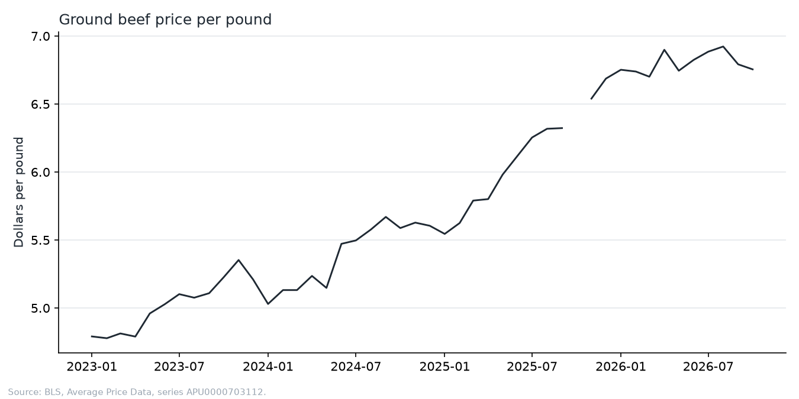

# Ground beef price per pound

On 2026-11-07 Axios charted the average U.S. price of a pound of ground beef
from January 2023 to September 2026. This study rebuilds that chart from the
Bureau of Labor Statistics (BLS) series it was drawn from, series
`APU0000703112`, ground beef, 100% beef, U.S. city average. The data is public
domain and comes from the BLS Public Data API.



The chart shows the price as BLS publishes it and gains each new month the day
BLS publishes it, with the CPI.

## What differs from the original

- **Months.** The original shows January 2023 to September 2026. This chart
  opens on the same months, reaches back to January 1984 and adds the months
  BLS has published since the post.
- **Missing months.** BLS collected no prices in October 2025, during the
  lapse in appropriations, so the series has no price for that month. The
  original skips the month; this chart leaves it empty. BLS also publishes no
  price for October 2012, without a note, and the chart leaves that month
  empty too.
- **Name.** The original's note calls the series the CPI for ground beef. It is
  an average price, collected for the CPI but not an index, and it is not
  seasonally adjusted.

## Checked against the original

The post's chart publishes the values it plots. On 2026-11-20 the BLS series
gave the same price, to the cent, for each of its 44 months, from
January 2023 to September 2026, when a pound cost $6.79.

## Reproduce

[`us_beef_prices.py`](us_beef_prices.py) fetches the series from its start in
1984 and writes the chart file [`beef.json`](beef.json), the figure and
[`numbers.json`](numbers.json). The rerun workflow runs it every weekday.

```bash
mise run install
uv run studies/us-beef-prices/us_beef_prices.py
```

The script needs no key. Set `BLS_API_KEY` to a BLS registration key to raise
the daily request limit.
